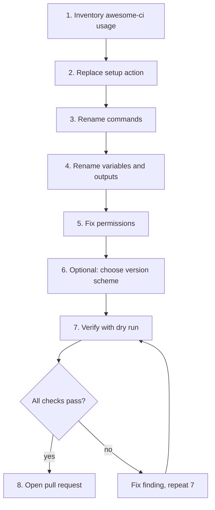

# Agent runbook: migrate a repository from awesome-ci to relctl

Paste everything below the line into a coding agent that has the target repository checked out and tell it: *"Migrate this repository from awesome-ci to relctl following this runbook."* The runbook is written for an agent: it is explicit, ordered and ends with checks. For the human-oriented version see [Migrating from awesome-ci](./migrating-from-awesome-ci.md).



---

## Runbook (copy from here)

You are migrating a repository from **awesome-ci** to **relctl**. Work on a new branch named `chore/migrate-to-relctl`. Make the smallest change that keeps behaviour identical. Do not change release behaviour (version scheme, branch rules) unless step 6 says so. Do not add AI attribution to commits or the pull request. Write everything in English.

### Rules

- Only edit CI configuration, scripts and documentation that mention awesome-ci. Do not touch application code.
- Never print or commit tokens. `GITHUB_TOKEN` must stay a secret reference.
- If a pattern below does not match what you find, stop and report it instead of guessing.

### Step 1 — Inventory

Find every usage:

```bash
grep -rniE 'awesome-ci|awesome_ci|\bACI_[A-Z_]+|aci_(patch_level|version_override)|fullstack-devops' \
  --exclude-dir=.git --exclude-dir=node_modules .
```

Also check for `.awesomerc.yaml` (written by `awesome-ci connect`; keep it and make sure it is git-ignored) and for Jenkinsfiles. Write the findings as a short list (file, line, what it is) in your working notes.

### Step 2 — Replace the setup action

| Find | Replace with |
| --- | --- |
| `uses: fullstack-devops/awesome-ci-action@<ref>` | `uses: layer87-labs/relctl-action@v1` |
| `uses: fullstack-devops/git-workflows/.github/workflows/generate-build-infos.yml@<ref>` | `uses: layer87-labs/relctl-action/.github/workflows/generate-build-infos.yml@v1` |
| `uses: fullstack-devops/git-workflows/.github/workflows/create-release.yml@<ref>` | `uses: layer87-labs/relctl-action/.github/workflows/create-release.yml@v1` |

The action needs `with: github-token: ${{ secrets.GITHUB_TOKEN }}`. Add it if missing. Reusable workflows take `secrets: token: ${{ secrets.GITHUB_TOKEN }}`.

### Step 3 — Rename commands

Replace the binary name in every shell step and script: `awesome-ci <args>` → `relctl <args>`. The sub-commands and flags are unchanged (`pr info`, `release create --merge-sha …`, `release publish --release-id … --asset …`, `parse …`, `connect …`, `transform …`).

### Step 4 — Rename variables and outputs

Replace the prefix `ACI_` with `RELCTL_` everywhere (workflow outputs such as `steps.<id>.outputs.ACI_NEXT_VERSION`, `env`, scripts):

`ACI_VERSION`, `ACI_NEXT_VERSION`, `ACI_LATEST_VERSION`, `ACI_RELEASE_ID`, `ACI_PR`, `ACI_PR_SHA`, `ACI_PR_SHA_SHORT`, `ACI_PR_BRANCH`, `ACI_MERGE_COMMIT_SHA`, `ACI_OWNER`, `ACI_REPO`, `ACI_PATCH_LEVEL`, `ACI_SILENT` → the same name with `RELCTL_`.

If the repository has many consumers of the old names that you cannot update in this change, add `RELCTL_LEGACY_ACI_ENV: "true"` to the environment of the relctl step instead (relctl then also exports `ACI_*` aliases) and note in the pull request that it must be removed later.

### Step 5 — Permissions

Make sure workflows that call relctl grant what it needs:

```yaml
permissions:
  contents: write        # create and publish releases
  pull-requests: write   # post the help comment on pull requests
```

Workflows that only run `relctl pr info` need `contents: read` and `pull-requests: write`. A reusable workflow cannot exceed its caller's permissions, so set them in the calling workflow. If a workflow uses `fetch-depth`, relctl needs `fetch-depth: 0` for CalVer and Conventional Commits.

### Step 6 — Version scheme (only if requested)

By default nothing changes: SemVer from the branch prefix (`major/`, `feature/`, `feat/`, `minor/`, `fix/`, `bugfix/`, `patch/`, `dependabot/`). Only if the task asks for another scheme, add `.relctl.yaml`:

```yaml
version_scheme: conventional-commits   # or: calver | changelog | semver
```

### Step 7 — Verify

1. Re-run the grep from step 1. It must find **no** `awesome-ci`, `fullstack-devops` or `ACI_` outside of an intentional `RELCTL_LEGACY_ACI_ENV` and of git history/changelogs.
2. Validate workflow syntax (for example `actionlint` if available).
3. If the workflow supports it, run the release step with `--dry-run` (`relctl release create --dry-run --merge-sha <sha>`) and check that the printed version is what awesome-ci would have produced.
4. Confirm no secret values are present in the diff.

### Step 8 — Pull request

Open a pull request titled `chore: migrate from awesome-ci to relctl`. The description must list: files changed, whether compatibility mode was used (and what must be cleaned up later), the dry-run result, and anything you could not migrate. Do not merge it yourself.

### Report format

Finish with a short report: **Changed**, **Not changed (and why)**, **Open risks**.
