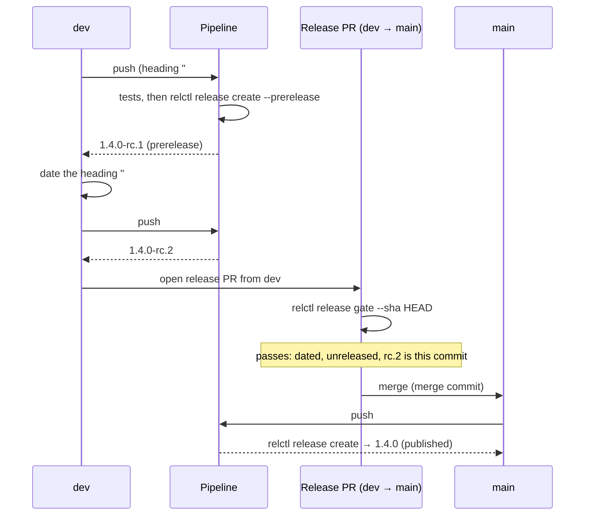

# Release flows

A *flow* is the way changes travel from a branch to a published release. relctl supports three; the version scheme you pick (see [Version schemes](./version-schemes.md)) follows from the flow.

| | Flow 1 — continuous, branch-driven | Flow 2 — continuous, automatic version | Flow 3 — reviewed release |
| --- | --- | --- | --- |
| Release trigger | every merge to `main` | every merge to `main` | merging a release pull request |
| Version from | branch prefix | commit messages or date | `CHANGELOG.md` heading |
| Scheme | `semver` | `conventional-commits`, `calver` | `changelog` |
| Human decides the version | when naming the branch | when writing the commit title | in the release pull request |
| Good for | libraries, CLIs, small teams | services, apps | products with deliberate releases, customer-facing versions |

## Flow 1 — continuous, branch-driven (SemVer)

```
feature/x ──PR──▶ main ──▶ relctl release create ──▶ draft release ──▶ build ──▶ publish
```

This is the classic awesome-ci flow. Name the branch `feature/…`, `fix/…` or `major/…` (or `feat!/…` for a breaking change), merge it, and the release job calculates the version.

```yaml
on:
  push:
    branches: [main]

permissions:
  contents: write
  pull-requests: write

jobs:
  release:
    runs-on: ubuntu-latest
    steps:
      - uses: actions/checkout@v6
        with: { fetch-depth: 0 }
      - uses: layer87-labs/relctl-action@v1
        with: { github-token: "${{ secrets.GITHUB_TOKEN }}" }
      - id: release
        run: relctl release create --merge-sha ${{ github.sha }}
        env: { GITHUB_TOKEN: "${{ secrets.GITHUB_TOKEN }}" }
      # build your artifacts with ${{ steps.release.outputs.RELCTL_VERSION }},
      # then: relctl release publish --release-id … --asset file=…
```

On pull requests, `relctl pr info` shows the version the PR would produce.

## Flow 2 — continuous, automatic version

Same shape as flow 1, but nobody names a branch for the version:

- **Conventional Commits** — squash-merge with titles such as `feat: …`, `fix: …`, `feat!: …`. Set `version_scheme: conventional-commits`.
- **CalVer** — the date is the version. Set `version_scheme: calver`.

## Flow 3 — reviewed release (changelog-driven)

```
feature/* ──PR──▶ dev ──release PR──▶ main ──▶ tag + published release
                   │                    (changelog heading dated)
                   └── release candidates (optional)
```

The release is a deliberate act: a pull request dates the topmost `CHANGELOG.md` heading (`## 1.4.0` → `## 1.4.0 — 2026-10-02`). Merging it to `main` *is* the release. Nothing is published by a stray push, and the version is visible in review.

- Work lands on `dev`; `main` only receives release pull requests.
- **Merge the release pull request with a merge commit**, not a squash. A squash puts a commit on `main` that `dev` never had and makes every later merge back conflict.
- Set `version_scheme: changelog`. On `main`, `relctl release create` reads the heading, uses the section as release notes and does nothing if the tag already exists.
- Keep `## ` headings in `CHANGELOG.md` strictly in the format described in [Version schemes](./version-schemes.md#changelog); the file is machine-read.

### Release candidates

Every push to `dev` can produce a release candidate. `relctl release create --prerelease` creates `X.Y.Z-rc.N`, marked as a GitHub prerelease, for the version in the topmost changelog heading. The heading may still be undated on `dev`.

- `N` is one more than the highest existing candidate of the same version (tags and releases, drafts included). The number is never written into a file.
- If `X.Y.Z` is already released, no candidate is created and the command succeeds. This keeps a merge back from `main` to `dev` from producing candidates for something that is already out.
- Candidates are never the base of a SemVer bump.

```bash
relctl release create --prerelease          # creates a draft 1.4.0-rc.3, prints its id
relctl release publish --release-id "$RELCTL_RELEASE_ID" --asset "file=dist/app"
```

Run the full test suite first and create the candidate last: a candidate then means "this commit passed".

### The release gate

`relctl release gate` is the check for the pull request that releases (`dev` → `main`). It passes only if

1. the topmost heading is a valid, **dated** version with release notes,
2. that version is **not released yet** (no published release, no tag), and
3. a release candidate tag `X.Y.Z-rc.N` points to **exactly the commit** being released (`--sha`, default `HEAD`). Use `--require-candidate=false` to skip this check.

All checks are always reported; the exit status is non-zero if one fails, so it works as a required status check.

```yaml
# .github/workflows/release-gate.yml
on:
  pull_request:
    branches: [main]
jobs:
  gate:
    runs-on: ubuntu-latest
    permissions: { contents: read }
    steps:
      - uses: actions/checkout@v6
        with: { fetch-depth: 0, ref: "${{ github.event.pull_request.head.sha }}" }
      - uses: layer87-labs/relctl-action@v1
        with: { github-token: "${{ secrets.GITHUB_TOKEN }}" }
      - run: relctl release gate --sha "${{ github.event.pull_request.head.sha }}"
        env: { GITHUB_TOKEN: "${{ secrets.GITHUB_TOKEN }}" }
```

### Putting it together



### Bringing `main` back into `dev`

After the release, `dev` must get the released state of `main` (the merge commit and the dated changelog heading). `relctl release forward` does that:

```bash
relctl release forward              # branches from .relctl.yaml
relctl release forward --from main --to dev --dry-run
```

- If `dev` already contains `main`, nothing happens.
- If `dev` is an ancestor of `main`, `dev` is **fast-forwarded**. This needs a token that may push to `dev`; with branch rules that require pull requests only a bypass actor can.
- Otherwise (the branches diverged, or the push is not allowed) a **pull request** `main` → `dev` is opened. **Merge it with a merge commit, do not squash it**: a squash creates a commit that `main` never had and causes conflicts with the next release.
- It is idempotent: a second run does not open a second pull request.

The branches come from [`.relctl.yaml`](./configuration.md) (`production_branch`, `development_branch`). The result is exported as `RELCTL_FORWARD_RESULT` (`nothing`, `fast-forward`, `pull-request`) and `RELCTL_FORWARD_PR`.

## Choosing

- Start with **flow 1** if you are coming from awesome-ci — nothing changes except the tool name (see the [migration guide](./migrating-from-awesome-ci.md)).
- Choose **flow 2** if you do not want branch-name conventions to carry meaning.
- Choose **flow 3** when a release needs a decision, a review, or a curated changelog.
