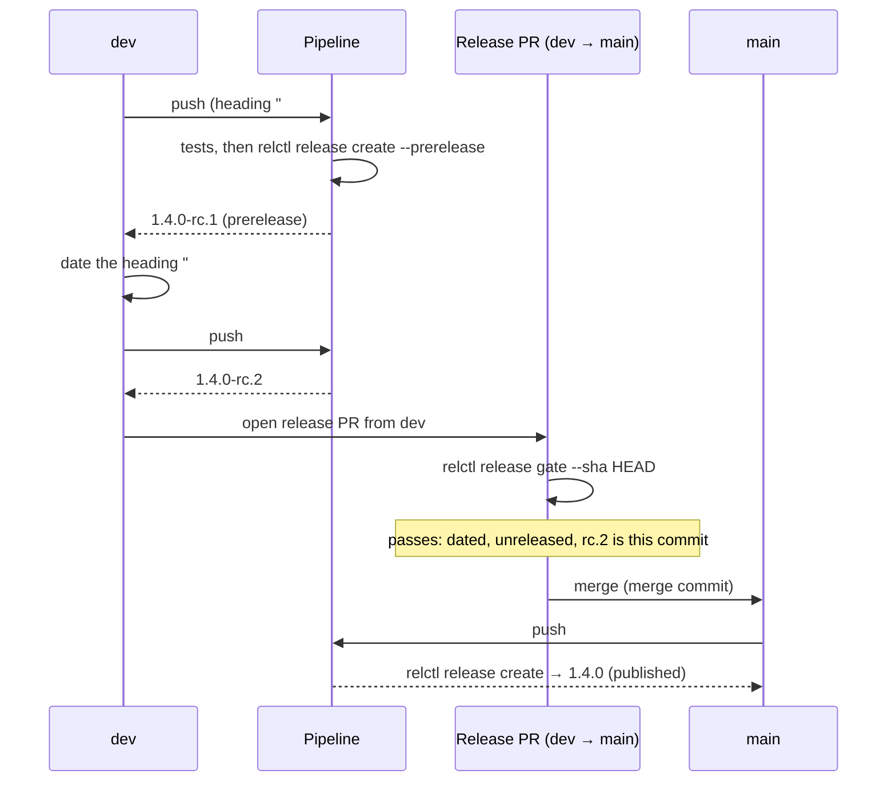

# Release flows

A *flow* is the way changes travel from a branch to a published release. relctl supports three; the version scheme you pick (see [Version schemes](./version-schemes.md)) follows from the flow.

| | Flow 1 — continuous, branch-driven | Flow 2 — continuous, automatic version | Flow 3 — reviewed release |
| --- | --- | --- | --- |
| Release trigger | every merge to `main` | every merge to `main` | merging a release pull request |
| Version from | branch prefix | commit messages or date | `CHANGELOG.md` heading |
| Scheme | `semver` | `conventional-commits`, `calver` | `changelog` |
| Human decides the version | when naming the branch | when writing the commit title | in the release pull request |
| Good for | libraries, CLIs, small teams | services, apps | products with deliberate releases, customer-facing versions |

## Flow 1 — continuous, branch-driven (SemVer)

```
feature/x ──PR──▶ main ──▶ relctl release create ──▶ draft release ──▶ build ──▶ publish
```

This is the classic awesome-ci flow. Name the branch `feature/…`, `fix/…` or `major/…` (or `feat!/…` for a breaking change), merge it, and the release job calculates the version.

```yaml
on:
  push:
    branches: [main]

permissions:
  contents: write
  pull-requests: write

jobs:
  release:
    runs-on: ubuntu-latest
    steps:
      - uses: actions/checkout@v6
        with: { fetch-depth: 0 }
      - uses: layer87-labs/relctl-action@v1
        with: { github-token: "${{ secrets.GITHUB_TOKEN }}" }
      - id: release
        run: relctl release create --merge-sha ${{ github.sha }}
        env: { GITHUB_TOKEN: "${{ secrets.GITHUB_TOKEN }}" }
      # build your artifacts with ${{ steps.release.outputs.RELCTL_VERSION }},
      # then: relctl release publish --release-id … --asset file=…
```

On pull requests, `relctl pr info` shows the version the PR would produce, whatever the version scheme.

## Flow 2 — continuous, automatic version

Same shape as flow 1, but nobody names a branch for the version:

- **Conventional Commits** — squash-merge with titles such as `feat: …`, `fix: …`, `feat!: …`. Set `version_scheme: conventional-commits`.
- **CalVer** — the date is the version. Set `version_scheme: calver`.

## Flow 3 — reviewed release (changelog-driven)

```
feature/* ──PR──▶ dev ──release PR──▶ main ──▶ tag + published release
                   │                    (changelog heading dated)
                   └── release candidates (optional)
```

The release is a deliberate act: a pull request dates the topmost `CHANGELOG.md` heading (`## 1.4.0` → `## 1.4.0 — 2026-10-02`). Merging it to `main` *is* the release. Nothing is published by a stray push, and the version is visible in review.

- Work lands on `dev`; `main` only receives release pull requests.
- **Merge the release pull request with a merge commit**, not a squash. A squash puts a commit on `main` that `dev` never had and makes every later merge back conflict.
- Set `version_scheme: changelog`. On `main`, `relctl release create` reads the heading, uses the section as release notes and does nothing if the tag already exists.
- Keep `## ` headings in `CHANGELOG.md` strictly in the format described in [Version schemes](./version-schemes.md#changelog); the file is machine-read.

### Release candidates

Every push to `dev` can produce a release candidate. `relctl release create --prerelease` creates `X.Y.Z-rc.N`, marked as a GitHub prerelease, for the version in the topmost changelog heading. The heading may still be undated on `dev`.

- `N` is one more than the highest existing candidate of the same version (tags and releases, drafts included). The number is never written into a file.
- If `X.Y.Z` is already released, no candidate is created and the command succeeds. This keeps a merge back from `main` to `dev` from producing candidates for something that is already out.
- Candidates are never the base of a SemVer bump.

```bash
relctl release create --prerelease          # creates a draft 1.4.0-rc.3, prints its id
relctl release publish --release-id "$RELCTL_RELEASE_ID" --asset "file=dist/app"
```

Run the full test suite first and create the candidate last: a candidate then means "this commit passed".

### The release gate

`relctl release gate` is the check for the pull request that releases (`dev` → `main`). It passes only if

1. the topmost heading is a valid, **dated** version with release notes,
2. that version is **not released yet** (no published release, no tag), and
3. a release candidate tag `X.Y.Z-rc.N` points to **exactly the commit** being released (`--sha`, default `HEAD`). Use `--require-candidate=false` to skip this check.

All checks are always reported; the exit status is non-zero if one fails, so it works as a required status check.

```yaml
# .github/workflows/release-gate.yml
on:
  pull_request:
    branches: [main]
jobs:
  gate:
    runs-on: ubuntu-latest
    permissions: { contents: read }
    steps:
      - uses: actions/checkout@v6
        with: { fetch-depth: 0, ref: "${{ github.event.pull_request.head.sha }}" }
      - uses: layer87-labs/relctl-action@v1
        with: { github-token: "${{ secrets.GITHUB_TOKEN }}" }
      - run: relctl release gate --sha "${{ github.event.pull_request.head.sha }}"
        env: { GITHUB_TOKEN: "${{ secrets.GITHUB_TOKEN }}" }
```

### Putting it together



### Bringing `main` back into `dev`

After the release, `dev` must get the released state of `main` (the merge commit and the dated changelog heading). `relctl release forward` does that:

```bash
relctl release forward              # branches from .relctl.yaml
relctl release forward --from main --to dev --dry-run
```

- If `dev` already contains `main`, nothing happens.
- If `dev` is an ancestor of `main`, `dev` is **fast-forwarded**. This needs a token that may push to `dev`; with branch rules that require pull requests only a bypass actor can.
- Otherwise (the branches diverged, or the push is not allowed) a **pull request** `main` → `dev` is opened. **Merge it with a merge commit, do not squash it**: a squash creates a commit that `main` never had and causes conflicts with the next release.
- If `dev` does not exist (for example because the repository deletes head branches on merge and the release pull request came from `dev`), it is **recreated** at the head of `main`. This only happens for the `development_branch` from `.relctl.yaml`, never for a name given with `--to`, and needs a token that may create branches. With `--dry-run` nothing is created; the result is `recreated` and the output says `Would recreate`.
- It is idempotent: a second run does not open a second pull request.

The branches come from [`.relctl.yaml`](./configuration.md) (`production_branch`, `development_branch`). The result is exported as `RELCTL_FORWARD_RESULT` (`nothing`, `fast-forward`, `pull-request`, `recreated`) and `RELCTL_FORWARD_PR`.

## Tag prefix

By default a release is tagged with its plain version: `1.2.3`. Set `tag_prefix` in [`.relctl.yaml`](./configuration.md#tag-prefix) to put a prefix in front of every tag and release, for example `v`:

```yaml
tag_prefix: v
```

relctl then creates `v1.2.3` and finds the latest release among the `v…` tags. The version stays plain everywhere else (`RELCTL_VERSION=1.2.3`, changelog heading `## 1.2.3`); `RELCTL_TAG` carries the prefixed name, for example for a container image tag. Repositories that already tag with `v` need this setting, otherwise their latest release is not found.

## Components

A repository that builds more than one deliverable, such as two container images, does not have to release them together. Each *component* has its own tag prefix, its own latest release and its own CalVer counter, so `api/202611.3.1` and `worker/202611.3.1` do not interfere. The settings are described in [Configuration](./configuration.md#components). Components use the `calver` or `changelog` scheme.

```yaml title=".relctl.yaml"
version_scheme: calver

components:
  api:
    paths:
      - services/api/**
      - libs/common/**
  worker:
    paths:
      - services/worker/**
      - libs/common/**
```

A change to `libs/common/` releases both images, a change to `services/api/` only `api`. The pipeline asks `relctl release changed` which components are affected, creates a draft release for those, builds and pushes the image, and publishes the release when the push succeeded:

```yaml title=".github/workflows/release.yaml"
name: Release
on:
  push:
    branches: [main]

permissions:
  contents: write
  packages: write

jobs:
  release:
    runs-on: ubuntu-latest
    strategy:
      matrix:
        component: [api, worker]
    env:
      GITHUB_TOKEN: ${{ secrets.GITHUB_TOKEN }}
      IMAGE: ghcr.io/example-org/example-repo-${{ matrix.component }}
    steps:
      - uses: actions/checkout@v6
        with: { fetch-depth: 0 }   # history and tags: needed by `release changed` and CalVer
      - uses: layer87-labs/relctl-action@v1
        with: { github-token: "${{ secrets.GITHUB_TOKEN }}" }

      - id: changed
        run: relctl release changed --component ${{ matrix.component }}

      - id: release
        if: steps.changed.outputs.RELCTL_CHANGED == 'true'
        run: relctl release create --component ${{ matrix.component }} --merge-sha ${{ github.sha }}

      # An already published release exports no release id: nothing is built twice.
      - if: steps.release.outputs.RELCTL_RELEASE_ID != ''
        uses: docker/login-action@v3
        with:
          registry: ghcr.io
          username: ${{ github.actor }}
          password: ${{ secrets.GITHUB_TOKEN }}
      - if: steps.release.outputs.RELCTL_RELEASE_ID != ''
        uses: docker/build-push-action@v6
        with:
          context: services/${{ matrix.component }}
          push: true
          tags: |
            ${{ env.IMAGE }}:${{ steps.release.outputs.RELCTL_VERSION }}
            ${{ env.IMAGE }}:latest
          labels: release-tag=${{ steps.release.outputs.RELCTL_TAG }}

      - if: steps.release.outputs.RELCTL_RELEASE_ID != ''
        run: |
          relctl release publish --component "${{ matrix.component }}" \
            --release-id "${{ steps.release.outputs.RELCTL_RELEASE_ID }}"
```

`relctl release changed` needs the full history and the tags, but no access to GitHub. It compares the files that differ between `HEAD` and the component's latest release (the highest release tag of the component that is reachable from `HEAD`; release candidates do not count) with the component's `paths`:

```text
$ relctl release changed --component api
Component api since api/202611.3.1: 1 of 2 changed files belong to it
  libs/common/c.go
Changed: true
```

- A component without a release counts as changed.
- `--since REF` compares with a commit or tag of your choice instead of the latest release; `RELCTL_LATEST_VERSION` is then empty.
- It exports `RELCTL_CHANGED` (`true` or `false`), `RELCTL_CHANGED_FILES` (the number of files that belong to the component), `RELCTL_COMPONENT` and `RELCTL_LATEST_VERSION`.

With the `changelog` scheme a component reads its own changelog (`changelog_file`). `relctl release gate --component NAME` checks that changelog and the release candidates of that component, and `relctl pr info --component NAME` previews the version of a component.

The image tag uses `RELCTL_VERSION` (`202611.3.2`), not `RELCTL_TAG`: with the default prefix the tag is `api/202611.3.2`, and a `/` is not allowed in an image tag. `RELCTL_TAG` is the name of the Git tag and of the release on GitHub.

## Variables

`relctl release create` and `relctl pr info` export their result as variables: to `$GITHUB_ENV` and as step outputs in GitHub Actions, to a file (`relctl.env`) in other CI systems. This table is the reference for all pages.

| Variable | Exported by | Value |
| --- | --- | --- |
| `RELCTL_VERSION` | `release create`, `pr info` | The version that was created: `X.Y.Z`, or `X.Y.Z-rc.N` for a release candidate. `pr info` exports the version the pull request would release. |
| `RELCTL_TAG` | `release create` | `RELCTL_VERSION` with the tag prefix of the repository or component: `v1.2.3`, `api/202611.3.1`. |
| `RELCTL_NEXT_VERSION` | `release create`, `pr info` | The release: `X.Y.Z`. For a release candidate it is the release the candidate is a candidate for, not the candidate. |
| `RELCTL_LATEST_VERSION` | `release create`, `pr info`, `release changed` | The latest published release. Never a candidate; for a component, the latest release of that component. Empty if there is none. |
| `RELCTL_PRERELEASE` | `release create` | `true` for a release candidate, otherwise `false`. |
| `RELCTL_COMPONENT` | `release create`, `release changed` | The component that is released; empty for the repository itself. |
| `RELCTL_RELEASE_ID` | `release create` | The id of the **draft** that a pipeline continues with (build, `release publish`). **Empty if the release is already published**, because there is nothing left to build or upload. |
| `RELCTL_VERSION_SCHEME` | `pr info` | The scheme that applies: `semver`, `conventional-commits`, `calver` or `changelog`. |
| `RELCTL_CHANGED`, `RELCTL_CHANGED_FILES` | `release changed` | Whether files of the component changed since its latest release, and how many. |

`RELCTL_PR_SHA`, `RELCTL_PR_SHA_SHORT` and the other pull request variables of `pr info` are listed in [CI integration](./ci-integration.md#step-outputs).

Guard every build step on the release id. In a pipeline with separate jobs, pass the id on as a job output and condition the jobs on it:

```yaml
jobs:
  release:
    runs-on: ubuntu-latest
    outputs:
      release-id: ${{ steps.release.outputs.RELCTL_RELEASE_ID }}
      version: ${{ steps.release.outputs.RELCTL_VERSION }}
    steps:
      # … checkout, setup, then:
      - id: release
        run: relctl release create
  build:
    needs: release
    if: needs.release.outputs.release-id != ''
    runs-on: ubuntu-latest
    steps:
      - run: echo "build ${{ needs.release.outputs.version }}"
```

## The release text

Every release has a text, whatever the flow:

| Situation | Text |
| --- | --- |
| `--body "text"` or `--body notes.md` | exactly that: a string, or the content of a file |
| `changelog` scheme | the section of the topmost `CHANGELOG.md` heading |
| otherwise | the notes GitHub generates: the merged pull requests since the last published release |

The generated notes are grouped by the categories of [`.github/release.yml`](https://docs.github.com/en/repositories/releasing-projects-on-github/automatically-generated-release-notes#configuring-automatically-generated-release-notes) if the repository has one, which is where a release template belongs. They start after the last *published* release, never after a release candidate, so a candidate and the final release both list everything since the last real release. If GitHub cannot generate the notes, relctl warns and the release is created without text.

`relctl release publish --asset ...` keeps the text and appends the uploaded files as a table:

| File | Size | SHA-256 |
| --- | ---: | --- |
| `relctl_2.10.1_linux-amd64` | 14.2 MiB | `…` |

## Choosing

- Start with **flow 1** if you are coming from awesome-ci — nothing changes except the tool name (see the [migration guide](./migrating-from-awesome-ci.md)).
- Choose **flow 2** if you do not want branch-name conventions to carry meaning.
- Choose **flow 3** when a release needs a decision, a review, or a curated changelog.
